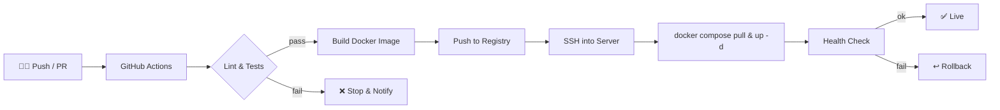
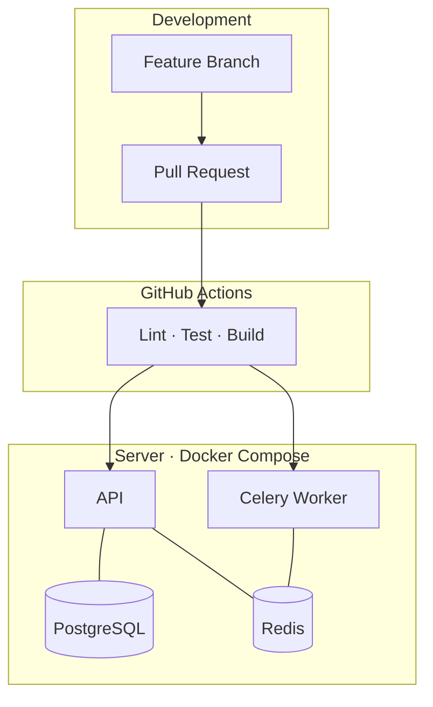

<div align="center">

# Jitesh Mohapatra

### AI Developer · Python Backend Engineer · DevOps & Scalable Deployment


</div>

---

## 👋 About Me

I build intelligent applications and take them all the way to production: from model and API development to containerized, automated, repeatable deployments.

- 🤖 **AI:** Computer Vision, NLP, OCR / document intelligence, LLM agents, RAG
- 🐍 **Backend:** Django / DRF, Flask, REST APIs, PostgreSQL, Redis, Celery
- 🚢 **DevOps:** Docker Compose deployments on Linux servers, GitHub Actions CI/CD, environment-based config
- 🌱 **Exploring:** LangGraph, multi-agent systems, multi-tenant SaaS architecture

---

## 🚢 DevOps & Scalable Deployment

I deploy production services with **Docker Compose** and automate delivery with **GitHub Actions**, so every merge to `main` can reach the server without manual steps.

### CI/CD Pipeline



### What I Practice

| Area | Approach |
|---|---|
| **Containerization** | Multi-service stacks (API, worker, DB, cache, broker) defined in Docker Compose |
| **CI/CD** | GitHub Actions: test → build → deploy on push to `main` |
| **Config & Secrets** | `.env` files and GitHub Secrets, never committed to the repo |
| **Persistence** | Named volumes for PostgreSQL and media/object storage |
| **Async Workloads** | Celery workers + Redis for background and scheduled jobs |
| **Reliability** | Restart policies, health checks, log inspection via `docker logs` |
| **Scalability** | Stateless services, worker scaling with `docker compose up --scale` |
| **Releases** | Zero-manual-step deploys, image tagging for rollback |

<details>
<summary><b>📦 Example: Docker Compose stack (click to expand)</b></summary>

```yaml
services:
  api:
    build: .
    command: gunicorn config.wsgi:application --bind 0.0.0.0:8000
    env_file: .env
    depends_on: [db, redis]
    restart: unless-stopped
    ports: ["8000:8000"]

  worker:
    build: .
    command: celery -A config worker -l info
    env_file: .env
    depends_on: [db, redis]
    restart: unless-stopped

  db:
    image: postgres:16
    env_file: .env
    volumes: [pgdata:/var/lib/postgresql/data]
    restart: unless-stopped

  redis:
    image: redis:7-alpine
    restart: unless-stopped

volumes:
  pgdata:
```

</details>

<details>
<summary><b>⚙️ Example: GitHub Actions deploy workflow (click to expand)</b></summary>

```yaml
name: CI/CD

on:
  push:
    branches: [main]

jobs:
  test:
    runs-on: ubuntu-latest
    steps:
      - uses: actions/checkout@v4
      - uses: actions/setup-python@v5
        with: { python-version: "3.12" }
      - run: pip install -r requirements.txt
      - run: python manage.py test

  deploy:
    needs: test
    runs-on: ubuntu-latest
    steps:
      - name: Deploy over SSH
        uses: appleboy/ssh-action@v1
        with:
          host: ${{ secrets.SERVER_HOST }}
          username: ${{ secrets.SERVER_USER }}
          key: ${{ secrets.SERVER_SSH_KEY }}
          script: |
            cd /opt/app
            git pull origin main
            docker compose up -d --build
            docker image prune -f
```

</details>

---

## 🛠️ Tech Stack

**Languages & Backend**


**DevOps & Cloud**


**Data & Messaging**


**AI / ML**


**Frontend & Integrations**


---

## 🧩 What I Build

- 📄 **Document intelligence:** OCR and PDF parsing pipelines, receipt management, reconciliation engines
- 👁️ **Computer vision:** object detection (YOLO), Azure Custom Vision models
- 🤖 **AI agents & automation:** LLM workflows, RAG, Telegram bots, webhook-driven automation
- 🌐 **Production backends:** REST APIs served from Dockerized stacks with automated deploys
- 📡 **IoT & monitoring:** MQTT-based device data pipelines and dashboards

---

## 🏗️ How I Ship



---

## 📊 GitHub Stats

<div align="center">


</div>

---

## 📫 Let's Connect

<div align="center">

[](https://www.linkedin.com/in/YOUR_LINKEDIN)
[](mailto:YOUR_EMAIL)

*Open to AI engineering, backend, and DevOps-focused roles and collaborations.*

</div>
