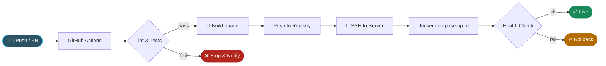
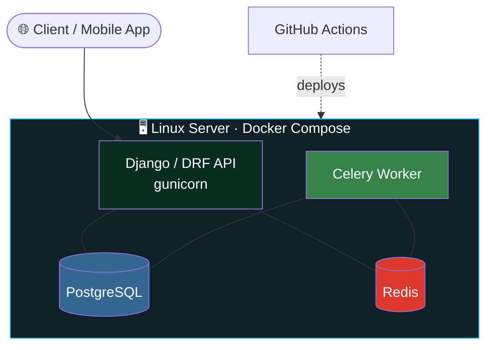

<div align="center">


<br/>


</div>

---

## 👨‍💻 About Me

```python
class Jitesh:
    role     = "AI Developer @ Bariflo Labs"
    location = "Bhubaneswar, Odisha 🇮🇳"
    focus    = ["Computer Vision", "NLP / LLM Agents", "Python Backend", "DevOps"]
    deploys  = "Docker Compose + GitHub Actions CI/CD"
    learning = ["LangGraph", "Multi-Agent Systems", "Multi-Tenant SaaS"]

    def mission(self):
        return "Turn AI prototypes into reliable, deployed products."
```

- 🤖 **AI** — Computer Vision, NLP, OCR / document intelligence, LLM agents, RAG
- 🐍 **Backend** — Django / DRF, Flask, REST APIs, PostgreSQL, Redis, Celery
- 🚢 **DevOps** — Dockerized stacks on Linux servers, GitHub Actions pipelines, env-based config
- 📡 **IoT** — MQTT device pipelines, monitoring dashboards

---

## 🧰 Tech Stack

<div align="center">

**Languages & Backend**<br/>


**DevOps & Cloud**<br/>


**AI / ML & Data**<br/>


</div>

<details>
<summary><b>➕ More tools (click to expand)</b></summary>
<br/>


</details>

---

## 🚢 DevOps & Scalable Deployment

I deploy production services with **Docker Compose** and automate delivery with **GitHub Actions**, so a merge to `main` reaches the server without manual steps.

### 🔄 CI/CD Pipeline



### 🏗️ Production Architecture



### ✅ What I Practice

| Area | Approach |
|---|---|
| 🐳 **Containerization** | Multi-service stacks (API, worker, DB, cache, broker) in Docker Compose |
| ⚙️ **CI/CD** | GitHub Actions: test → build → deploy on push to `main` |
| 🔐 **Config & Secrets** | `.env` files + GitHub Secrets, never committed |
| 💾 **Persistence** | Named volumes for PostgreSQL and media / object storage |
| ⏱️ **Async Workloads** | Celery workers + Redis for background and scheduled jobs |
| 🩺 **Reliability** | Restart policies, health checks, log inspection |
| 📈 **Scalability** | Stateless services, worker scaling via `docker compose up --scale` |
| 🏷️ **Releases** | Image tagging for quick rollback |

<details>
<summary><b>📦 Example: Docker Compose stack</b></summary>

```yaml
services:
  api:
    build: .
    command: gunicorn config.wsgi:application --bind 0.0.0.0:8000
    env_file: .env
    depends_on: [db, redis]
    restart: unless-stopped
    ports: ["8000:8000"]

  worker:
    build: .
    command: celery -A config worker -l info
    env_file: .env
    depends_on: [db, redis]
    restart: unless-stopped

  db:
    image: postgres:16
    env_file: .env
    volumes: [pgdata:/var/lib/postgresql/data]
    restart: unless-stopped

  redis:
    image: redis:7-alpine
    restart: unless-stopped

volumes:
  pgdata:
```

</details>

<details>
<summary><b>⚙️ Example: GitHub Actions deploy workflow</b></summary>

```yaml
name: CI/CD

on:
  push:
    branches: [main]

jobs:
  test:
    runs-on: ubuntu-latest
    steps:
      - uses: actions/checkout@v4
      - uses: actions/setup-python@v5
        with: { python-version: "3.12" }
      - run: pip install -r requirements.txt
      - run: python manage.py test

  deploy:
    needs: test
    runs-on: ubuntu-latest
    steps:
      - name: Deploy over SSH
        uses: appleboy/ssh-action@v1
        with:
          host: ${{ secrets.SERVER_HOST }}
          username: ${{ secrets.SERVER_USER }}
          key: ${{ secrets.SERVER_SSH_KEY }}
          script: |
            cd /opt/app
            git pull origin main
            docker compose up -d --build
            docker image prune -f
```

</details>

<details>
<summary><b>🛠️ Handy Docker Compose commands I use</b></summary>

```bash
docker compose up -d --build         # build & start
docker compose logs -f api           # follow API logs
docker compose up -d --scale worker=3  # scale workers
docker compose exec api python manage.py migrate
docker compose ps                    # service health
```

</details>

---

## 🧩 What I Build

<table>
<tr>
<td width="50%" valign="top">

### 📄 Document Intelligence
OCR and PDF parsing pipelines, receipt management and multi-bank reconciliation engines.

### 👁️ Computer Vision
Object detection with YOLO and Azure Custom Vision models.

</td>
<td width="50%" valign="top">

### 🤖 AI Agents & Automation
LLM workflows, RAG, Telegram bots and webhook-driven automation.

### 🌐 Production Backends
REST APIs served from Dockerized stacks with automated deploys and IoT (MQTT) data pipelines.

</td>
</tr>
</table>

---

## 📊 GitHub Analytics

<div align="center">


</div>

---

## 📫 Let's Connect

<div align="center">

[](https://www.linkedin.com/in/YOUR_LINKEDIN)
[](mailto:YOUR_EMAIL)
[](https://github.com/YOUR_GITHUB_USERNAME)

*Open to AI engineering, backend and DevOps-focused roles and collaborations.*


</div>
